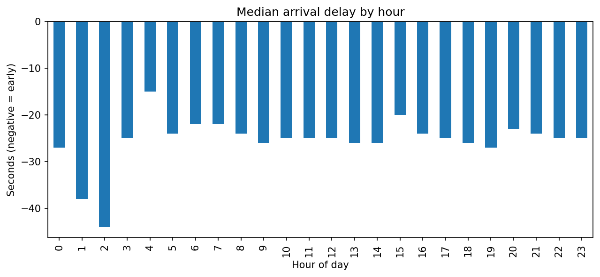
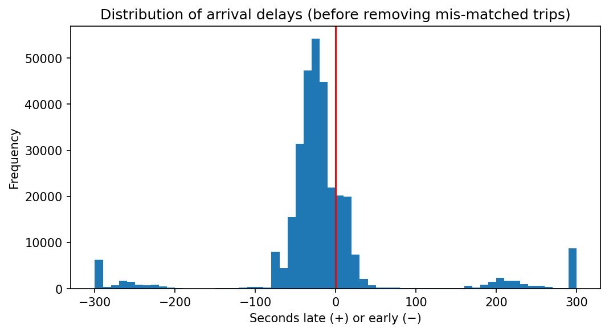

# Sydney Metro Punctuality

How punctual is Sydney Metro, and when and where do delays happen?

This project analyses three months of real-time Sydney Metro North West Line data
(April–June 2022, Tallawong to Chatswood) published by Transport for NSW.

> **Status: in progress.** Data collection, cleaning and first exploration are done.

## Data

- **Source:** [Transport for NSW Open Data Hub](https://opendata.transport.nsw.gov.au/),
  *Historical GTFS and GTFS Realtime* dataset (Creative Commons Attribution licence).
- **Period:** 1 April – 30 June 2022. No data was available for 9–10 April and 26 June.
- **Size:** each raw day is about 2.6 million rows (~100 MB zipped), because the feed
  records a fresh prediction for every upcoming stop every few seconds. The download
  script keeps only the **last prediction for each trip at each stop**, which shrinks a
  day to about 4,500 rows (~360,000 rows for the whole period).

## Findings so far

Based on 89 days of real-time data (1 Apr – 30 Jun 2022): about 26,500 trips and 297,000 arrivals after cleaning.

- **Metro is very punctual.** After cleaning, **89.6%** of arrivals are within 1 minute of the timetable
  and **95.0%** within 5 minutes. When trains are off, they're about twice as likely to be early
  (6.8% by more than a minute) as late (3.6%).
- **Trains usually run slightly early.** The median arrival is about **25 seconds ahead of schedule**,
  and this barely changes through the day.

  

- **Dwell time is fixed.** Doors stay open for about **56 seconds** at every station, so dwell
  time doesn't explain delays.
- **6.4% of trips were mis-matched in the feed.** 1,699 trips were shifted by about 4 minutes
  (one peak-hour headway) with almost no variation between stops. That's a train matched to the
  wrong timetable slot, not a real delay. These cluster on a few days (up to about half of all
  trips on 7 April) and were removed before calculating punctuality. Almost all are on weekdays,
  when peak trains run every 4 minutes (Fridays worst, weekends almost none), which supports the
  headway explanation.

  

- **Real disruptions are rare but severe.** On the evening of 19 April, four trips ran about
  1–2 hours late, with the same delay at every stop, which means the trains were held.
- **Trip counts depend on the day type:** about 346 trips on weekdays, 375 on Fridays,
  fewer on weekends, and public holidays run a Sunday timetable.

## How to run it

1. Install the requirements: `pip install -r requirements.txt`
2. Get a free API key from the [Transport for NSW Open Data Hub](https://opendata.transport.nsw.gov.au/)
   and put it in a file called `.env`:
   ```
   TFNSW_API_KEY=your_key_here
   ```
3. Download and reduce the data: `python download_metro.py`
   (takes a while; it's safe to stop and re-run)
4. Open `table.ipynb` to see the analysis.

## Files

| File | What it does |
|---|---|
| `probe_historical.py` | Checks which dates in the archive actually contain data |
| `download_metro.py` | Downloads April–June 2022 and shrinks each day to one row per trip per stop |
| `table.ipynb` | Cleaning, exploration and charts |
| `figures/` | Charts used in this README |
